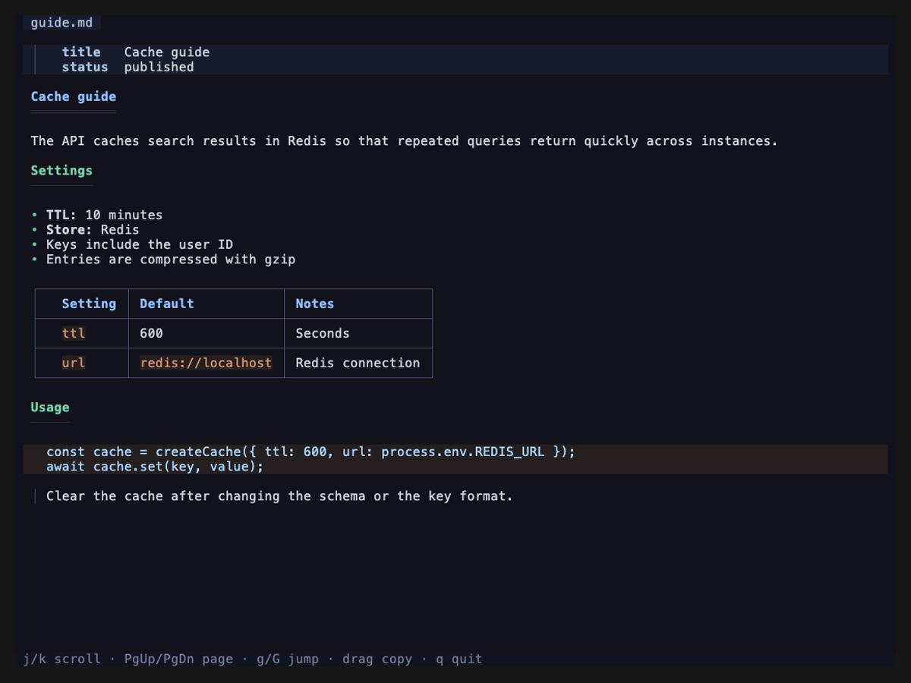
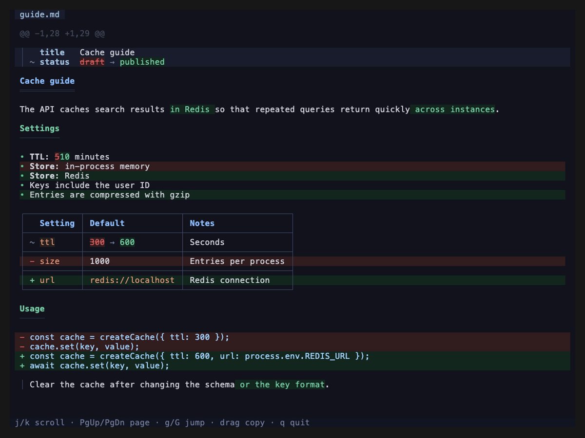

# mdcat

Render Markdown files and Markdown diffs as rich text in the terminal. In a diff, added blocks are green, removed blocks are red, and edited paragraphs, list items, and table cells show inline word diffs.

| `mdcat guide.md` | `mdgit diff` |
| --- | --- |
|  |  |

## Installation

Supported runtimes:

- Bun 1.3 or later
- Node.js 26.4 or later

```sh
bun install -g @shqld/mdcat
# or
npm install -g @shqld/mdcat
```

The installed commands start with Node.js. To run them with Bun, pass the file to Bun, for example `bun $(which mdcat) README.md`.

To update, run `mdcat --update`. It installs the latest version with Bun or npm, whichever installed `mdcat` globally.

## Usage

### mdcat

`mdcat` renders Markdown files. With no file, it reads stdin and renders it as a diff when it contains one, or as a Markdown document otherwise.

```sh
mdcat README.md docs/*.md
mdcat --watch notes.md
cat README.md | mdcat
git diff | mdcat
```

`--watch` (`-w`) renders the files again whenever they are saved, and keeps the scroll position.

### mdgit

`mdgit diff` and `mdgit show` take the same arguments as `git diff` and `git show`, and render only the Markdown files in the result.

```sh
mdgit diff
mdgit diff --cached
mdgit diff HEAD~3..HEAD -- docs/
mdgit show HEAD~1
mdgit show HEAD:docs/guide.md
```

### Keys

Scroll with the arrow keys or `j`/`k`, jump with `g`/`G`, and quit with `q`. Press `/` to search, then `n`/`N` for the next and previous match; the search ignores case unless the query contains an uppercase letter. Dragging selects and copies text. Click a `<details>` summary to toggle it.

### Links

Click a link to a Markdown file (`.md` or `.markdown`) to open it in place, and press `b` or Backspace to go back. A relative link opens the local file next to the current one, and an `http` or `https` link downloads the page. Other links are passed to the terminal as hyperlinks for `http`, `https` and `mailto` only. Following links needs hyperlink support, so it is off when `FORCE_HYPERLINK=0`.

Opening a link is limited so that a document cannot do more than show you another document:

- Nothing is fetched until you click.
- A page downloaded from the web can only link to other `http` and `https` pages, never to local files, and redirects must stay on `http` and `https`.
- A downloaded page must be `text/markdown` or `text/plain`, at most 5 MiB, and arrive within 10 seconds. No cookies or credentials are sent.
- A local link must point to a regular file of at most 5 MiB; directories, pipes and devices are refused.
- Relative links never reach the terminal as hyperlinks, and control characters in documents are not written to the terminal.

## Development

```sh
bun install
bun run check
```

To release, bump the version, then publish a GitHub release for the tag; GitHub Actions publishes it to npm:

```sh
npm version patch
git push --follow-tags
gh release create "v$(jq -r .version package.json)" --generate-notes
```

## License

MIT
